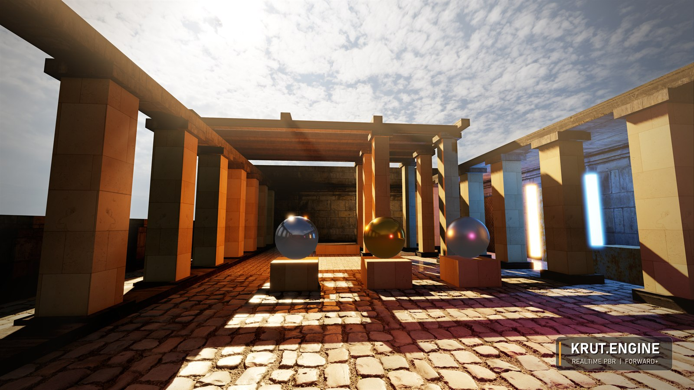
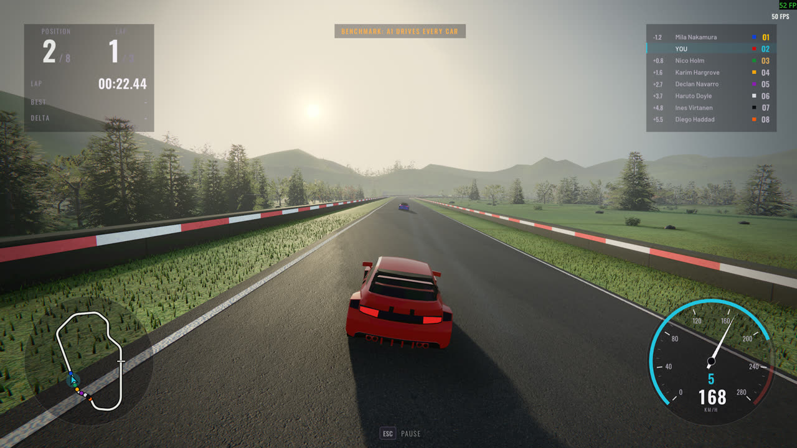

# William Eklund

**Systems & Game Developer | C# / .NET**  
*Game engines, low-level networking, backend systems, and performance.*

 

  

> *💡 **Note:** After developing the Krut 3D engine and my core systems in local repositories, I've recently started migrating my active development, benchmarks, and open-source libraries onto GitHub.*

---

### ⚙️ Krut Engine `v3.2`
> *A modern 3D game engine built solo in C# 14 / .NET 10 with a Quake/Source-inspired BSP workflow, Forward+ PBR rendering, GPU compute VFX, and structural destruction.*

  

* **Graphics Backends & Core:** Custom SDL3 / SDL_GPU host (`Krut.Engine.Gpu`) for **Direct3D 12** & **Vulkan** (`-driver` or live option), render graph with transient texture aliasing, welded 16-bit indexed world geometry (**−36% buffer size**), offline HLSL &rarr; DXIL/SPIR-V with hot-reload & **100% PSO pre-warming (0 late pipelines)**, background JIT warmup (**7,600+ methods**), and `krut-cook` offline asset cooking (BC1–BC7 KTX2, cooked meshes/anims, collision/nav caches, AES-256-GCM `.pak`).
* **Forward+ & Lighting:** Tile + clustered **Forward+** (32 px compute tile culling with depth slabs, Hi-Z GPU light occlusion culling, portal & frustum culling), unified Cook-Torrance GGX PBR (multiple-scattering energy compensation, specular AA, POM, ORM, emissive) across levels, props & skinned models, custom GI lightmapper (directional lightmaps, one-bounce GI, decorrelated sky rays, `AmbientLobe` baked specular), **LTC area lights** (tubes/rects/disks), **screen-space contact shadows**, translucent shadow maps, procedural spot cookies, half-res normal SSAO & SSR, per-cluster parallax probes, cached height-blended `AmbientColumn` model probes (**800 &rarr; 13 rays/frame** in static scenes), and **froxel volumetric fog & light shafts**.
* **131k GPU VFX, Liquid Gore & Post-Processing:** 131,072-capacity compute **`GpuParticleSystem`** (vector fields, curl turbulence, depth collision, GPU depth sort, lit soft smoke/fire injected into froxel fog), `RibbonRenderer` trails, 3D box-clipped projective decal volumes, two-pass **volumetric liquid blood pools** (wet Fresnel, meniscus, growing/merging pools, wall drips, edge-first drying) & per-part viewmodel gore stains, explosion shockwave refraction & heat-haze distortion, auto-exposure with zone EV bias, bokeh DoF, chromatic aberration, and 3D `.cube` LUT zones.
* **Image Clarity & Hardcore Performance:** Native sharpness with MSAA (2x/4x/8x, 4x default) and sharp post-AA (SMAA / CMAA2) — strictly no TAA or upscaler smear. **~0.3 KB/frame** steady-state allocations (`SustainedLowLatency` GC), **−40% RAM footprint** after load, first-shot/first-fracture pre-warming (&lt;1.4 ms first hit), and live quality tiers (`r_tier`: Low–Ultra) targeting **144 FPS** at 1440p on an RTX 3060.
* **Destruction, Physics & Ragdolls:** TrenchBroom `.map`/`.bsp` workflow, Voronoi-fractured walls (`func_destructible`) with interior lightmap aliasing, blast chipping & flood-filled structural cascade collapse (`CollapseCells`, **0.005 ms flood fill, 6.5 ms/frame full building demolition**), `FuncGlass` & `BreakableBody` compounds, swept capsule `CharacterMotor` over a triangle BVH, **Jitter2** rigid bodies (6 substeps, speculative contacts), 11-capsule articulated ragdolls with pose-matched joints, self-collision filtering & **procedural mesh limb severing/caps** (`SkinnedModelInstance.Cuts`), `JointManager` constraints, `func_water` volumes (Gerstner waves, buoyancy, caustics, swimming), CDLOD heightmap terrain with GPU wind foliage, 3D splines, Rayleigh/Mie sky & dynamic weather.
* **AI, Audio & Custom GPU UI (Kui):** **DotRecast** navmeshes with off-thread dynamic obstacle carving, `SampleCover` queries, `Perception` (view cone &times; LOS &times; player irradiance query + `NoiseBus` hearing) & allocation-free **Behavior Trees** with typed blackboards; **FMOD Core 2.03** mixer hierarchy with raycast acoustic occlusion, room reverb zones, DSP chains & beat-synced interactive music; custom GPU retained UI (**Kui** `.kui`/`.kss` — zero ImGui in game, data bindings, hot-reload, gamepad nav, i18n with Arabic shaping, in-world `UiSurface`s, `SecondaryView` camera feeds) plus in-engine dev console, per-section allocation profiler, gizmo inspector, named-pipe IPC (`\\.\pipe\krut-console`), and crash minidumps.
* **Scale, Native AOT & 4,100+ Tests:** **~350k+ LOC** (**~210k LOC** in `Krut.Engine` alone) built 100% solo, **4,100+ automated xUnit tests** (~3,050 engine + ~1,050 game, ~68k LOC), deterministic headless simulation, golden-capture visual regression runner (`-lighttest` enforcing **&lt;0.25% pixel delta between D3D12 and Vulkan**), and **Native AOT** shipping builds (`x86-64-v2/v3` SIMD).

---

### 🕹️ Games Built on Krut

<table>
  <tr>
    <td width="50%" valign="top">
      <h4 align="center">🏎️ Krut.Racing</h4>
      
      

        Online multiplayer spec racer with an authoritative dedicated server per race, client prediction, custom fixed-step kinematic simcade vehicle physics (friction ellipse, weight transfer, suspension, downforce, drafting, FWD/RWD/AWD), and a Dockerised <b>ASP.NET Core & PostgreSQL</b> backend with Steam auth, append-only ledger, and HMAC-SHA256 verified payouts.
      

      

        
        
        
      

    </td>
    <td width="50%" valign="top">
      <h4 align="center">🚇 Commute (Krut.FPS)</h4>
      
      

        Started as a 10-minute playable vertical slice on itch.io (v1.8, <i>Subway Station</i>) and expanded on <b>Krut.Engine v3.2</b> into a photoreal full-PBR shooter: Voronoi wall fracture with bending steel rebar, sliding ledge debris & support-graph building collapse (<i>Villa</i>), <b>100% code-generated procedural VFX</b> (zero FX texture packs) with lingering GPU smoke pushed by 4 live vector fields (player wake, blasts, passing bullets), tactical arsenal with layered animations & reload-beat camera punches, 3-wall bullet penetration, physical door/crate breach kicks, shrapnel-traced explosions with shockwave distortion, growing volumetric liquid blood pools, procedural dismemberment & weapon/glove gore stains, behavior-tree squad AI with player-luminance stealth & dynamic navmesh door carving, and live 15 Hz 3D CCTV monitors.
      

      

        
        
        
      

    </td>
  </tr>
</table>

---

### ⚡ Open Source

* **[Krut.Netcode](https://github.com/Cedsson/Krut.Netcode)** `MIT` — High-performance, authoritative multiplayer netcode library for .NET.
  * **Zero allocations:** Steady-state messaging produces 0 B GC pressure with object pooling.
  * **Prediction & Reconciliation:** Instant local inputs with tick rewinds and smooth correction blending.
  * **Link Degradation Simulator:** Built-in simulation of latency spikes, burst packet loss, and jitter.

---

### 🛠️ Tech & Systems

* **Languages & Core:** `C# 14` &middot; `.NET 10` &middot; `Native AOT` &middot; `HLSL` &middot; `SDL3 / SDL_GPU` &middot; `C/C++`
* **Graphics & Simulation:** `Direct3D 12` &middot; `Vulkan` &middot; `Forward+ Rendering` &middot; `PBR / HDR` &middot; `GPU Compute Particles` &middot; `Structural Destruction` &middot; `SMAA / CMAA2` &middot; `Jitter2 Physics` &middot; `DotRecast AI` &middot; `FMOD Core`
* **Backend & Infrastructure:** `ASP.NET Core` &middot; `PostgreSQL` &middot; `EF Core` &middot; `Docker` &middot; `Steamworks Auth` &middot; `GitHub Actions`
