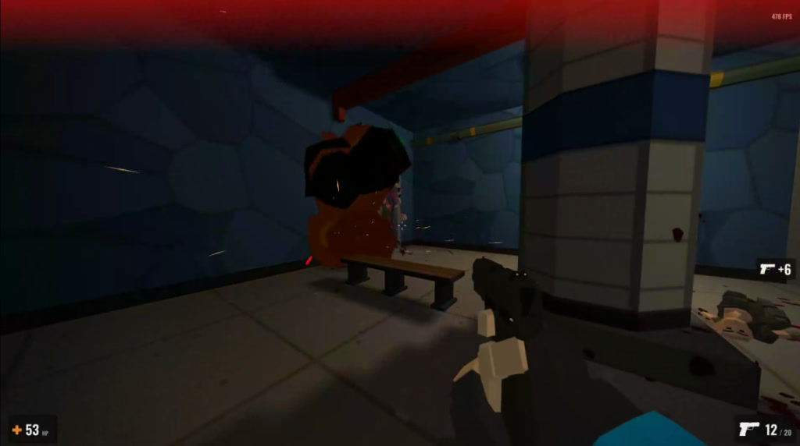

# William Eklund

**Systems & Game Developer | C# / .NET**  
*Game engines, low-level networking, backend systems, and performance.*

 

  

> *💡 **Note:** After developing the Krut 3D engine and my core systems in local repositories, I've recently started migrating my active development, benchmarks, and open-source libraries onto GitHub.*

---

### ⚙️ Krut Engine `v3.2`
> *A modern 3D game engine built solo in C# 14 / .NET 10 with a Quake/Source-inspired BSP workflow, Forward+ PBR rendering, GPU compute VFX, and structural destruction.*

  

* **Graphics & Core:** Custom SDL3 / SDL_GPU host (`Krut.Engine.Gpu`) for **Direct3D 12** & **Vulkan**, render graph, offline HLSL &rarr; DXIL/SPIR-V with hot-reload, and `krut-cook` offline asset cooking (KTX2, encrypted `.pak`).
* **Forward+ & Lighting:** Tile + clustered Forward+ with Hi-Z & portal light culling, unified Cook-Torrance GGX PBR with POM, custom GI lightmapper (directional + one-bounce), LTC area lights, contact & translucent shadows, SSAO, SSR, parallax probes, and froxel volumetric fog.
* **GPU VFX, Gore & Post:** 131k GPU compute particles (vector fields, lit smoke/fire), 3D decal volumes, volumetric liquid blood pools & viewmodel gore, shockwave/heat-haze distortion, auto-exposure, bokeh DoF, and 3D LUT zones.
* **Image Clarity:** Native sharpness with MSAA 4x + SMAA/CMAA2 — strictly no TAA or upscaler smear. Live quality tiers targeting **144 FPS** at 1440p on an RTX 3060.
* **Destruction, Physics & World:** TrenchBroom `.map`/`.bsp` workflow, Voronoi-fractured walls (`func_destructible`) with structural cascade collapse, triangle BVH capsule collision, Jitter2 rigid bodies/ragdolls/joints, breakable compounds, Gerstner water, and CDLOD terrain.
* **AI, Audio & UI:** DotRecast navmeshes with dynamic carving, luminance-based sight perception & Behavior Trees; FMOD Core 2.03 with raycast acoustic occlusion & beat-synced music; custom GPU retained UI (**Kui** `.kui`/`.kss`) with in-world screens & camera feeds.
* **Scale & Architecture:** Modular xUnit-tested subsystems (~68k LOC tests), golden-capture visual regression tests, **Native AOT** builds, and **~350k+ LOC** (**~210k LOC** in `Krut.Engine`) maintained solo.

---

### 🕹️ Games Built on Krut

<table>
  <tr>
    <td width="50%" valign="top">
      <h4 align="center">🏎️ Krut.Racing</h4>
      
      

        Online multiplayer spec racer with an authoritative dedicated server, client prediction, custom simcade vehicle physics, and an <b>ASP.NET Core & PostgreSQL</b> backend with Steam auth and HMAC-signed results.
      

      

        
        
        
      

    </td>
    <td width="50%" valign="top">
      <h4 align="center">🚇 Commute (Krut.FPS)</h4>
      
      

        Started as a 10-minute vertical slice on itch.io (v1.8) and expanded on <b>Krut.Engine v3.2</b> into a photoreal, destructive FPS: Voronoi wall fracture with bending rebar and support-graph building collapse, 100% procedural combat VFX & vector-field smoke, bullet penetration, volumetric blood pools, behavior-tree squad AI, and live 3D CCTV monitors.
      

      

        
        
        
      

    </td>
  </tr>
</table>

---

### ⚡ Open Source

* **[Krut.Netcode](https://github.com/Cedsson/Krut.Netcode)** `MIT` — High-performance, authoritative multiplayer netcode library for .NET.
  * **Zero allocations:** Steady-state messaging produces 0 B GC pressure with object pooling.
  * **Prediction & Reconciliation:** Instant local inputs with tick rewinds and smooth correction blending.
  * **Link Degradation Simulator:** Built-in simulation of latency spikes, burst packet loss, and jitter.

---

### 🛠️ Tech & Systems

* **Languages & Core:** `C# 14` &middot; `.NET 10` &middot; `Native AOT` &middot; `HLSL` &middot; `SDL3 / SDL_GPU` &middot; `C/C++`
* **Graphics & Simulation:** `Direct3D 12` &middot; `Vulkan` &middot; `Forward+ Rendering` &middot; `PBR / HDR` &middot; `GPU Compute Particles` &middot; `Structural Destruction` &middot; `SMAA / CMAA2` &middot; `Jitter2 Physics` &middot; `DotRecast AI` &middot; `FMOD Core`
* **Backend & Infrastructure:** `ASP.NET Core` &middot; `PostgreSQL` &middot; `EF Core` &middot; `Docker` &middot; `Steamworks Auth` &middot; `GitHub Actions`
