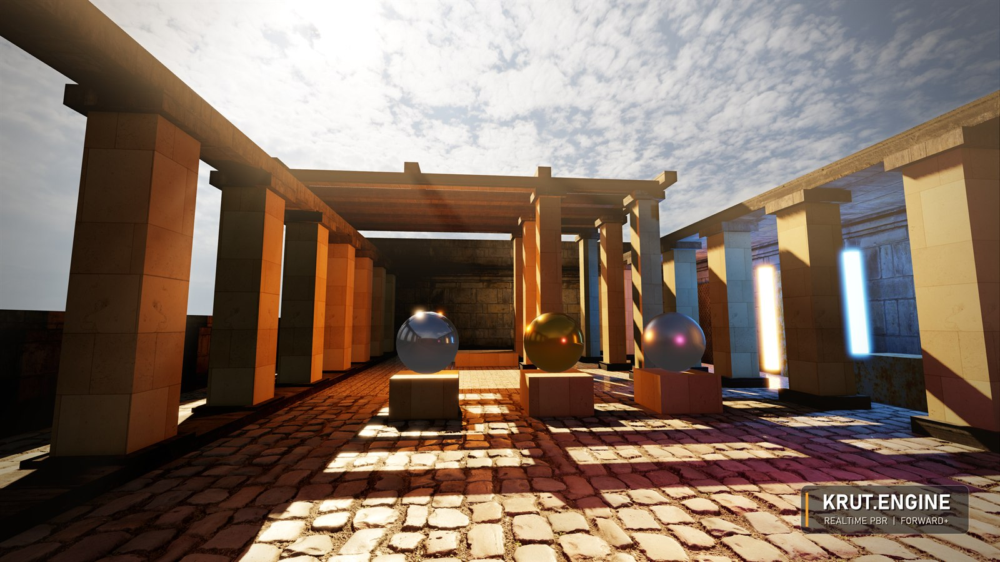
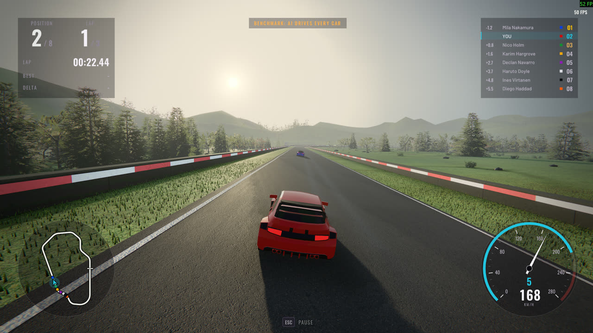
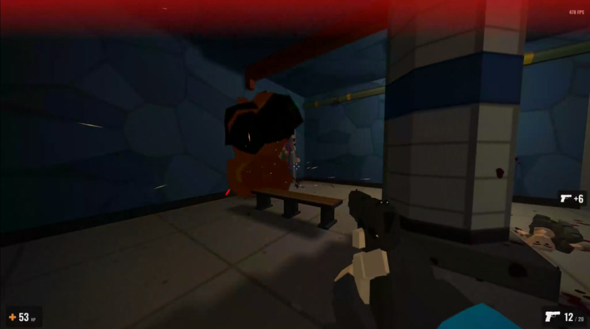

# William Eklund

**Systems & Game Developer | C# / .NET**  
*Game engines, low-level networking, backend systems, and performance.*

 

  

> *💡 **Note:** After developing the Krut 3D engine and my core systems in local repositories, I've recently started migrating my active development, benchmarks, and open-source libraries onto GitHub.*

---

### ⚙️ Krut Engine `v2.0`
> *A modern 3D game engine built solo in C# / .NET 10 with a Quake/Source-inspired BSP workflow and modern high-end rendering.*

  

* **Graphics Backends:** Custom GPU abstraction layer (`Krut.Engine.Gpu`) supporting **Direct3D 12** and **Vulkan**. Shaders written in HLSL, compiled offline to DXIL and SPIR-V.
* **Advanced Rendering:** Forward+ (clustered) renderer with linear HDR, tonemapping, full PBR level geometry (metallic/roughness, normal maps, ORM, emissive), directional lightmaps, SSAO, SSR with parallax-corrected reflection probes, and volumetric light/fog.
* **Image Clarity Philosophy:** Native resolution sharpness with MSAA and sharp post-process AA (CMAA2) — strictly no TAA, no upscaler smear. Targeting **144 FPS** at 1080p on an RTX 3060.
* **World & Simulation:** TrenchBroom `.map`/`.bsp` CSG workflow, portal and frustum culling, custom triangle BVH capsule collision, and Jitter2 physics.
* **Scale & Architecture:** Modular subsystem design tested via xUnit, deterministic headless simulation, **Native AOT** compilation, and **~240k+ LOC** maintained together across Krut.Engine, Krut.Racing, and Commute (Krut.FPS).

---

### 🕹️ Games Built on Krut

<table>
  <tr>
    <td width="50%" valign="top">
      <h4 align="center">🏎️ Krut.Racing</h4>
      
      

        Online multiplayer racing game with an authoritative dedicated server, client prediction, car physics, and an <b>ASP.NET Core & PostgreSQL</b> backend with Steam authentication.
      

      

        
        
        
      

    </td>
    <td width="50%" valign="top">
      <h4 align="center">🚇 Commute</h4>
      
      

        A 10-minute <b>vertical slice and tech demo for Krut.Engine 1.8</b>, built to integrate and test all subsystems in a playable FPS: Forward+ rendering, capsule-vs-triangle collision, FMOD spatial audio occlusion, and AI navmeshes.
      

      

        
        
        
      

    </td>
  </tr>
</table>

---

### ⚡ Open Source

* **[Krut.Netcode](https://github.com/Cedsson/Krut.Netcode)** `MIT` — High-performance, authoritative multiplayer netcode library for .NET.
  * **Zero allocations:** Steady-state messaging produces 0 B GC pressure with object pooling.
  * **Prediction & Reconciliation:** Instant local inputs with tick rewinds and smooth correction blending.
  * **Link Degradation Simulator:** Built-in simulation of latency spikes, burst packet loss, and jitter.

---

### 🛠️ Tech & Systems

* **Languages & Core:** `C#` &middot; `.NET 10` &middot; `Native AOT` &middot; `HLSL` &middot; `C/C++`
* **Graphics & Simulation:** `Direct3D 12` &middot; `Vulkan` &middot; `Forward+ Rendering` &middot; `PBR / HDR` &middot; `CMAA2` &middot; `Jitter2 Physics` &middot; `FMOD`
* **Backend & Infrastructure:** `ASP.NET Core` &middot; `PostgreSQL` &middot; `Docker` &middot; `Steamworks Auth`
